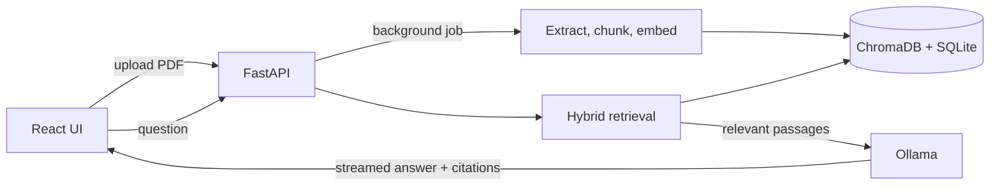

# AI Knowledge Assistant

Upload a PDF, ask questions in plain English, and get answers that **cite the pages they came from**.
Everything runs locally: no API keys and no data leaves your machine.

> Add a screenshot or GIF here: `docs/demo.gif` (record one after your first run).

## What it does

- Reads a PDF in the background and shows indexing progress.
- Finds relevant passages with **hybrid search**: semantic vectors plus BM25 keywords, merged with reciprocal rank fusion.
- Skips the language model entirely when nothing relevant is found, instead of letting it guess.
- Streams the answer live, with `[1]`, `[2]` citations that link to the exact passages.
- Keeps several documents at once; identical files are only indexed once.

## How it works



1. **Ingest**: pypdf extracts text per page. Sentence-aware chunks (about 800 characters, 150 overlap, overlap may cross pages) remember their page range.
2. **Index**: each chunk is embedded with `all-MiniLM-L6-v2` and stored in ChromaDB. Document status lives in SQLite.
3. **Retrieve**: vector search and BM25 each propose candidates, reciprocal rank fusion merges them, and anything under the similarity threshold is dropped.
4. **Answer**: the passages go to a local Ollama model with a strict prompt (use only the sources, cite them, say "not found" otherwise). Tokens stream to the browser.

## Run it

### Option A: Docker (everything at once)

```bash
docker compose up --build
docker compose exec ollama ollama pull llama3.2:1b   # first time only
```
Open http://localhost:8080. API docs: http://localhost:8000/docs

### Option B: manually

Requirements: Python 3.10+, Node 20+, [Ollama](https://ollama.com).

```bash
ollama pull llama3.2:1b

# backend
cd backend
python -m venv venv
# Windows: venv\Scripts\activate      macOS/Linux: source venv/bin/activate
pip install -r requirements.txt
uvicorn app.main:app --reload --port 8000

# frontend (new terminal)
cd frontend
npm install
npm run dev
```
Open http://localhost:5173

## Configuration

Copy `backend/.env.example` to `backend/.env`. All values are optional.

| Variable | Default | Meaning |
|---|---|---|
| `OLLAMA_MODEL` | `llama3.2:1b` | Any model you have pulled; larger models answer better |
| `OLLAMA_URL` | `http://localhost:11434` | Where Ollama runs |
| `MAX_UPLOAD_MB` / `MAX_PAGES` | `20` / `300` | Upload limits |
| `CHUNK_SIZE` / `CHUNK_OVERLAP` | `800` / `150` | Characters per chunk |
| `TOP_K` | `5` | Passages sent to the model |
| `MIN_SIMILARITY` | `0.2` | Passages below this cosine similarity are ignored |
| `FRONTEND_ORIGINS` | localhost:5173 | Comma-separated allowed browser origins |

## API

| Method | Path | Purpose |
|---|---|---|
| POST | `/documents` | Upload a PDF (returns 202, indexes in the background) |
| GET | `/documents`, `/documents/{id}` | List documents / check status |
| DELETE | `/documents/{id}` | Remove a document and its indexed text |
| POST | `/ask` | Answer a question (one JSON reply) |
| POST | `/ask/stream` | Same, streamed as newline-delimited JSON events |
| POST | `/search` | Retrieval only (`mode`: `hybrid`, `vector`, `keyword`) |
| GET | `/health` | Server and Ollama status |

## Tests and evaluation

```bash
cd backend
pip install -r requirements-test.txt
pytest -q          # unit and API tests; no model or database needed
ruff check .
```

Tests run against in-memory fakes (`tests/fakes.py`), so CI needs neither Ollama nor PyTorch.

**Measure retrieval quality on your own PDF.** Copy `backend/eval/questions.example.json` to `questions.json`, write 25-30 questions with the page that answers each, start the backend, then:

```bash
cd backend
python eval/run_eval.py --pdf path/to/your.pdf --questions eval/questions.json --answers
```

Paste your results here (run it yourself; do not estimate):

| Mode | hit@5 | MRR |
|---|---|---|
| vector | _fill in_ | _fill in_ |
| keyword | _fill in_ | _fill in_ |
| **hybrid** | _fill in_ | _fill in_ |

## Design decisions

- **Hash-based document IDs**: the same file is never indexed twice and two files can share a name.
- **Embed before delete**: re-indexing computes new vectors first, so a failure cannot wipe good data.
- **Similarity gate before the LLM**: a small model will happily invent an answer; refusing to call it when retrieval finds nothing is more reliable than prompting alone.
- **Fakes instead of mocks in tests**: the same retrieval code runs in tests and production.
- **Background ingestion with a status endpoint**: uploads return immediately; large PDFs do not block requests.

## Limitations

- Scanned (image-only) PDFs are not supported; there is no OCR.
- Tables and multi-column layouts may extract in a jumbled order.
- A 1B-parameter model gives weak answers on complex questions; try a larger Ollama model.
- No authentication: this is meant to run on your own machine.
- Indexing uses an in-process background task, so a restart marks unfinished documents as failed (upload them again).
